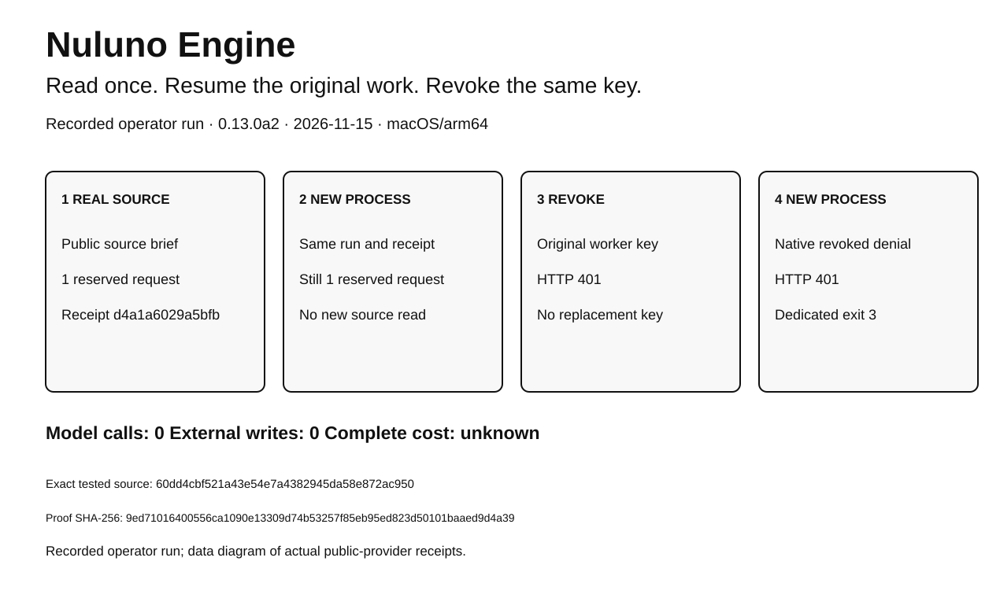

# Nuluno Engine Community

**Sales experiments your AI agent can actually run.**

Product URL → source-checked facts → ad and landing drafts → saved receipts for
the next experiment.

A self-hosted sales and growth engine for persistent goals, evidence-backed
workflows and checked method updates, usable through MCP.

**New source workbench:** two messaging angles, ad drafts and actual landing
HTML, with exact sources behind the facts. It creates reviewable drafts and an
experiment specification; it does not publish ads or establish a sales winner.
Missing prices, complete costs and growth effects remain unknown. This source
addition is **not in the immutable alpha.2 release assets**.

[Explore the Engine-generated lab preview](https://engine.nuluno.com/lab?lang=en) ·
[Run the campaign workbench](examples/campaign/README.md) ·
[Inspect a real Engine campaign](docs/evidence/campaign-engine-20261116.json) ·
[Open/download its control HTML](docs/examples/campaign-engine-control.html) ·
[Open/download its alternative HTML](docs/examples/campaign-engine-candidate.html)

The hosted lab presents actual recorded Engine artifacts; hosted live
generation is not connected. Run the source below to generate for your own URL.

From a new checkout containing this source addition, with **Node 24, npm and
Python 3.9+** installed:

```sh
git clone https://github.com/wangthewhale/nuluno-engine-community.git
cd nuluno-engine-community
node scripts/try-campaign.mjs --url https://www.sqlite.org/index.html --out my-campaign
```

Replace the URL with your own public product page when ready. Open
`my-campaign/starter/landing-control.html` and `landing-candidate.html`.
No model key or social login is required. Without `--candidate`, both messaging
frames are explicitly labeled starter templates: no audience inference or AI
learning has occurred. An external agent can inspect the saved research, write
its own candidate and pass `--candidate ./reviewed.json --revision reviewed`.
Same source/run/quota, new explicit local draft; no extra source GET.

[Recorded source-only campaign trial](docs/evidence/campaign-one-command-20261116.json):
real public read, same artifact after a fresh process, original-key revocation,
then native denial with exit 3. This local operator check is not a sales result.

**Free core:** S01 product research. **Separate paid library:** 99 goals ·
134 graphs · 188 folders.

[Compare the free core and paid full library](https://engine.nuluno.com/?lang=en).
The free core and this public trial do not require a paid library.

Make a real public-source brief. Restart the process. Recover the original run
and receipt. Revoke that worker and confirm that the same key stays denied.

[One-command trial (Node 24)](docs/one-command-trial.md) ·
[Try the real task](#first-run-make-something-you-can-use) ·
[Let your agent set it up](SETUP.md) ·
[Inspect the 2026-11-15 proof](docs/evidence/first-use-anonymous-alpha2-20261115.json) ·
[Anonymous run of published source (2026-11-16)](docs/evidence/one-command-published-20261116.json)



*Recorded 2026-11-15 · macOS/arm64 · operator run.*

## Tell your agent

```text
Use Nuluno Engine. Read https://raw.githubusercontent.com/wangthewhale/nuluno-engine-community/main/SETUP.md
and run its real
public first-use task. Show the source brief, original receipt and native
revocation proof. Preserve the original task/state; keep credentials private.
```

The free Apache-2.0 core includes the S01 public-product-research starter,
persistent work, MCP and bounded method checks. Bring your own model/host and
actual platform authority for broader tasks. The separately licensed sales
library is not required for this public trial.


[Anonymous GitHub install + Codex-authored Notavue campaign](docs/evidence/campaign-notavue-anonymous-20261116.json): one original source read, two product-specific angle hypotheses, the same saved campaign after restart, and original-key denial after revocation. Maintainer-run technical evidence; no customer acquisition or sales lift is claimed.

## From a URL to something you can review

| Deliverable | What the campaign workbench actually does |
|---|---|
| Product facts | Scans the whole bounded source text, not only its opening excerpt; preserves exact quoted fragments and both raw-body and visible-text hashes |
| Audience angles | Accepts a human/model candidate with original fact references; labels motives and creative messages as unvalidated hypotheses |
| Ads and landing pages | Produces two ad drafts, escaped HTML pages and a sales brief; no platform login, publishing or ad spend |
| Next experiment | Saves a control/candidate specification; waits for verified native exposure, qualified conversion and cost evidence |
| Continuity | Reuses original read and campaign artifacts after a restart; revoked access still fails |

The [recorded own-product example](docs/evidence/campaign-engine-20261116.json)
uses real reads of the Engine page and machine catalog, two caller-authored
angles, and generated HTML you can download and open locally. The
[MCP acceptance receipt](docs/evidence/campaign-engine-acceptance-20261116.json)
records native readback and restart checks; the original worker was then revoked
and received 401. Engine made no model calls or platform writes. The caller in this
example was Codex; the engine did not autonomously invent or learn the method.
There are no measured conversions or adopted winners in this example.

Before this addition, the first task delivered a bounded source brief. The
workbench adds usable campaign artifacts without replacing the reliable
read/retry/restart/revocation path. Install from the reviewed source containing
`examples/campaign/`; do not expect those files in an older release archive.
The [MCP procedure](examples/campaign/README.md) lists the four scoped tools and
the exact candidate format. A running operator gateway is required.

## First run: make something you can use

Requires **Python 3.9+ and Node 20+**. No Nuluno account, model API key or social
login is needed for this public-read example. Run from a new source checkout:

```sh
git clone https://github.com/wangthewhale/nuluno-engine-community.git
cd nuluno-engine-community
python3 -m venv .venv
.venv/bin/python -m pip install .
npm --prefix deploy/mcp-gateway ci --omit=dev --ignore-scripts
ENGINE_PYTHON=.venv/bin/python node examples/source-brief/brief.mjs \
  --url https://www.python.org/ --out my-source-brief
```

Open **`my-source-brief/brief.md`**. It contains a real bounded source excerpt,
the original URL, body hash and receipt ID. The source remains untrusted data;
the excerpt can omit prices or conditions. The proof JSON records actual
execution with unknown complete costs left unknown.

Run the last command again. A new service process opens the same saved run and
returns its original receipt. It preserves the one-read quota instead of making
a new task. Private local state stays inside the output folder and is ignored
by Git. [Commands and recovery details](examples/source-brief/README.md).

## Three things to try

| Situation | Useful action | What you can verify |
|---|---|---|
| Collect evidence before writing about a product | Create a source brief for a public HTTPS page | URL, original observation and body/receipt hashes |
| Continue research after restarting an agent | Rerun with the same output folder | Same run/request/receipt and one reserved provider request |
| Stop a worker that should no longer read | Add `--revoke` to the same command | Its original key receives 401; a later run remains denied |

The [version-bound alpha.2 Linux receipt](docs/evidence/first-use-0.13.0a2-20261115.json) records the exact source commit, a real public GET, original-receipt reuse across separate service processes, original-key revocation and a later fresh process exiting with code 3. The [preceding preflight](docs/evidence/first-use-preflight-20261115.json) remains unchanged. These are operator-run technical checks, not external human adoption or sales improvement. Linux core CI also exercised an actual persistent container replacement.

## What the core contains

- Persistent tasks, scoped worker authority, source evidence and cost unknowns.
- Standard MCP through an independently hosted gateway.
- Bounded artifact proposals, validation, adoption and rollback mechanisms.
- An operator-controlled installer for separately licensed, data-only methods.

The full **99-goal / 134-graph / 188-folder** commercial library is separate from
this free starter. Installation provides no platform credentials or running
model worker. The current community version is **0.13.0a2**, using the isolated
`nuluno_engine_community.growth_loop` namespace; existing commercial releases
and their customer rights remain separate.

## Learning includes rejecting a bad method

We froze three AI-authored method proposals and tested them on nine real public
sources. V3 retained 7/9 required facts versus its prefix baseline's 2/9, but
missed two necessary facts. Every proposal was rejected before adoption.
[All failures, criteria and replay instructions are public](examples/method-learning/README.md).

That experiment does not establish unattended method generation, model-weight
training, sales lift or a complete-cost advantage. A useful next contribution
is a reproducible failure and a new method with independently evaluated evidence.

## Help improve the first task

If installation fails, open a [first-run issue](https://github.com/wangthewhale/nuluno-engine-community/issues/new/choose)
with your runtime versions, failed step and sanitized receipt. Keep keys, state
folders and customer data private. There is no automatic telemetry or background
daemon in this example.

[Technical guide](docs/technical-guide.md) · [S01 procedure](docs/S01-starter.md) ·
[Deployment](docs/deployment.md) · [Method packs](docs/method-packs.md) ·
[Security](SECURITY.md) · [Contributing](CONTRIBUTING.md) · [License](LICENSE)

## Client identity and authorization

The SDK identifies its actual Nuluno Community version. A confirmed Cloudflare 403 / Error 1010 is reported as `transport_client_identity_rejected` with `requiresOwnerAuthorization: false`; it is a transport identity problem. Structured invalid-key, revoked-key and scope-denial responses remain authorization failures. This classification never renews a key, expands a grant or retries a possibly dispatched POST.
