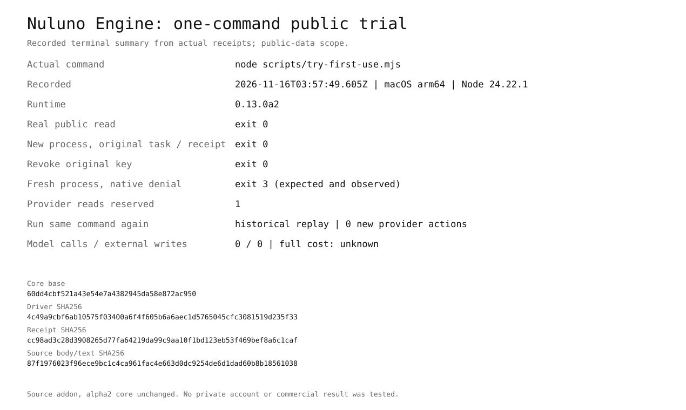

# One command. A real public task and a real revocation check.

From a reviewed current source checkout, run:

```sh
node scripts/try-first-use.mjs
```

Requires Node 24 with npm, Python 3.9+ with `venv`, and Internet access for dependency installation and one public page. This is a local trial; no Nuluno account, model key or paid extension is required.

For a first installation, obtain and review the source first:

```sh
git clone https://github.com/wangthewhale/nuluno-engine-community.git
cd nuluno-engine-community
```

Then run the one command above. If you already have a checkout or goal workspace, preserve it; do not clone over it or reset its state. This addon lives in current `main`; the existing tagged release still supports the [manual helper](../examples/source-brief/README.md).

The command creates an isolated temporary consumer, installs this checkout, and runs the existing alpha2 helper through four separate processes:

1. Read a real public page and save `brief.md` with its source URL, body hash and receipt.
2. Reopen the original run and receipt with a one-request quota.
3. Revoke the original key.
4. Start a fresh service process and require the original key to fail with native HTTP 401. Exit 3 is the expected result of this last helper invocation; the complete driver exits 0 only after checking it.

Results are saved in `nuluno-engine-trial/`. Run the same command again to display the saved trial. It does not create a replacement goal, key or provider request. This replay is labelled historical; it is not a fresh provider check. If a partial output already exists, the driver stops and preserves it; use the original helper and state to diagnose the failure.

The driver copies reviewed source into a private temporary directory. It does not replace your existing virtual environment, installed Engine or goal state. Dependency installation may take several minutes. Source requests, local compute, network and dependency setup have costs; the complete cost is unknown. No timeout, rate limit or permission denial is turned into a successful fixture result.

To change the public source on a **new** trial, choose a new output directory explicitly:

```sh
node scripts/try-first-use.mjs --out another-public-trial --url https://www.python.org/
```

This new driver is an addon in current `main`; it is not present in the immutable alpha2 source tag. The recorded trial used alpha2 base commit `60dd4cbf521a43e54e7a4382945da58e872ac950` plus the exact driver hash recorded in the [machine receipt](evidence/one-command-first-use-20261116.json). Core and original helper were unchanged. New customers should review the current checkout rather than assume a tag contains later documentation or scripts.



[Actual terminal lines](evidence/one-command-terminal-20261116.txt) · [Machine receipt](evidence/one-command-first-use-20261116.json) · [Existing helper and manual procedure](../examples/source-brief/README.md)

This verifies public research, state reuse and revocation. Sales improvement, qualified leads, private social publishing and unattended self-evolution are not established by this trial.

## Anonymous published-source check

An anonymous clean checkout of `f5f950c669da887b181ca3ddee2184707b6f1aea` also ran the one command and its recorded replay successfully. [Exact commit-bound machine record](evidence/one-command-published-20261116.json). The expected helper exits were `[0, 0, 0, 3]`; the later driver replay performed zero new provider actions. This separately records the published-source check and does not replace the earlier operator trial. The existing alpha2 tag and assets remain unchanged.
